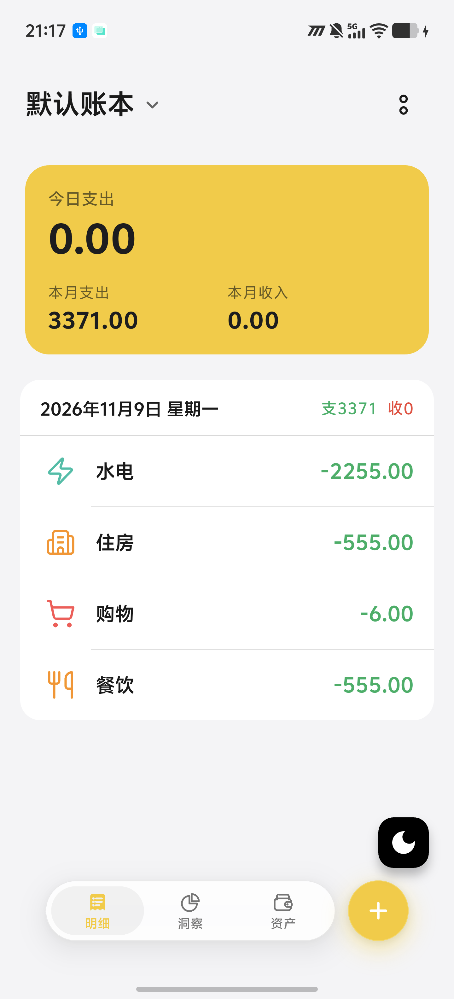
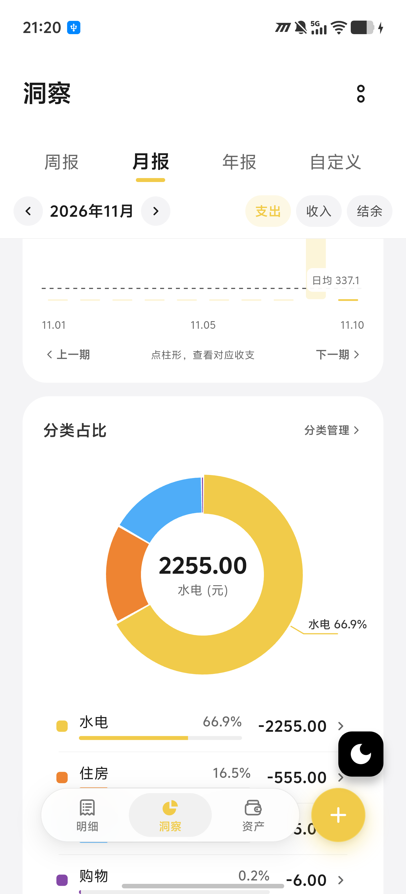
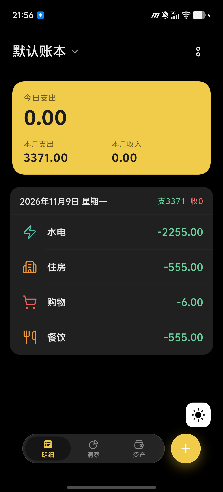
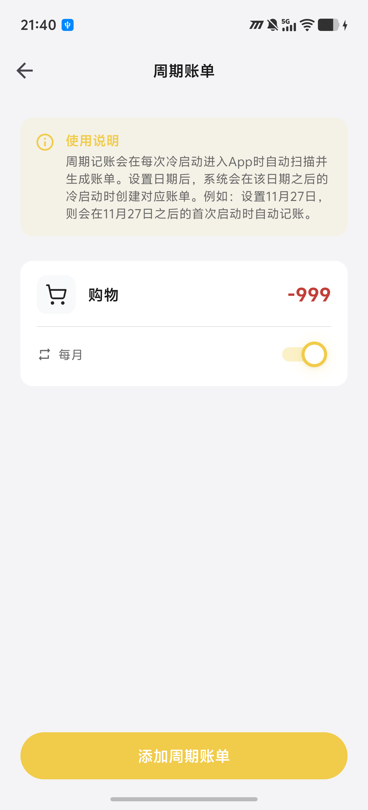

# BeeCount-UI

<div align="center">


**基于 [蜜蜂记账 (BeeCount)](https://github.com/TNT-Likely/BeeCount) 的现代 UI/UX 重构发行版**

</div>

---

## 项目概述

**BeeCount-UI** 是针对开源个人财务管理应用 [BeeCount](https://github.com/TNT-Likely/BeeCount) 开发的独立用户界面重构版本。本项目完整继承了上游版本稳定的数据内核、离线优先存储机制、多端同步引擎（BeeCount Cloud / iCloud / Supabase / WebDAV / S3）以及 AI 智能记账能力，并在此基础上构建了一套全新的现代化视觉规范与交互系统（Origin Design System）。

### 上游致谢与合规声明

- 本项目核心业务逻辑、数据模型、同步协议及人工智能识别能力均来源于上游项目 **[TNT-Likely/BeeCount](https://github.com/TNT-Likely/BeeCount)**，谨此向原作者 [@TNT-Likely](https://github.com/TNT-Likely) 及所有上游贡献者致以诚挚谢意。
- 本项目严格遵循原项目根目录 [LICENSE](LICENSE) 许可协议进行非商业开源分发，完整保留原始版权声明与协议约束。

---

## 界面预览

以下截图均采集自 Android 真机运行环境（基于最新代码编译）：

<div align="center">
  <table>
    <tr>
      <td align="center"><b>首页明细流</b></td>
      <td align="center"><b>洞察与环形统计</b></td>
      <td align="center"><b>半屏记账键盘</b></td>
      <td align="center"><b>深色模式</b></td>
      <td align="center"><b>周期账单管理</b></td>
    </tr>
    <tr>
      <td align="center"></td>
      <td align="center"></td>
      <td align="center"></td>
      <td align="center"></td>
      <td align="center"></td>
    </tr>
  </table>
</div>

---

## 重构特性与架构设计

### 1. Origin 视觉规范与交互体系
- **卡片化信息层级**：重构首页、洞察报表、资产账户、AI 小助手、周期账单及系统设置等核心界面，采用统一圆角卡片与克制的留白间距，提升账务数据的可读性与视觉焦点。
- **悬浮导航与沉浸式输入**：引入悬浮胶囊式底部导航栏与全应用主题跟随；优化记账键盘为半屏交互弹窗，支持账户切换、快捷标签与连续记账操作。
- **数据可视化增强**：洞察模块重新设计收支趋势柱状图及多色环形分类占比饼图，支持百分比折线标注与二级分类金额降序明细。
- **深色模式适配**：提供完整的纯黑质感暗黑主题切换能力，适配 OLED 屏幕显示需求。

### 2. 非侵入式工程架构（Zero-Conflict Architecture）
为确保能够持续且低成本地合并上游核心功能与安全补丁，本项目采用严格的代码隔离策略：
- **目录完全隔离**：所有重构页面、基础组件、样式表及视图状态均独立存放于 `lib/custom_ui/` 目录下：
  - `lib/custom_ui/pages/`：29 个独立重构页面实现（覆盖首页、洞察、资产、日历、预算、AI 对话、周期记账、分类与标签管理等模块）。
  - `lib/custom_ui/widgets/`：40 余个标准封装组件（包含 `OriginScaffold`、`OriginBottomNavBar`、`OriginDialog`、`OriginBottomSheet`、`OriginCard`、`OriginHeroCard`、`OriginKeypad`、`OriginAnalyticsPie` 等），确保全应用交互与视觉表达高度统一。
  - `lib/custom_ui/styles/` & `providers/`：独立的主题样式定义与视图级状态适配层。
- **业务逻辑复用**：界面层通过 Riverpod 直接订阅上游 `lib/providers/` 暴露的状态与数据流，不修改 `lib/data/`（数据库模型）、`lib/cloud/`（同步协议）及 `lib/pages/` 原生文件，实现与上游源码的最小表面积耦合。

---

## 本地构建与运行

### 环境要求
- Flutter SDK: `3.27+`
- Dart SDK: 与对应 Flutter 版本匹配
- Android Studio / Xcode（用于对应平台编译打包）

### 常用指令

```bash
# 1. 克隆仓库并切换至 UI 重构分支
git clone -b custom-ui-v4 https://github.com/chenjindongchn/BeeCount-UI.git
cd BeeCount-UI

# 2. 获取依赖
flutter pub get

# 3. 运行开发版（Dev Flavor）
flutter run --flavor dev

# 4. 构建 Android 发布版 APK
flutter build apk --flavor prod --release
```

> 注：若本地 Gradle 版本检查提示兼容性拦截，可在构建命令后附加 `--android-skip-build-dependency-validation` 参数跳过验证。

---

## 开源协议

本项目基于上游 **BeeCount 软件许可协议（[LICENSE](LICENSE) / [LICENSE_EN](LICENSE_EN)）** 开源发布：

- **个人使用、学习研究、非营利组织内部使用及开源贡献**：完全免费。
- **衍生源码要求**：基于本软件的修改版本必须公开源代码，且不得移除原版权声明与作者标识。
- **商业使用**：任何商业产品集成、付费服务或营利性用途，均须联系原著作者获取书面商业授权，详见 [COMMERCIAL_LICENSE.md](COMMERCIAL_LICENSE.md)。
