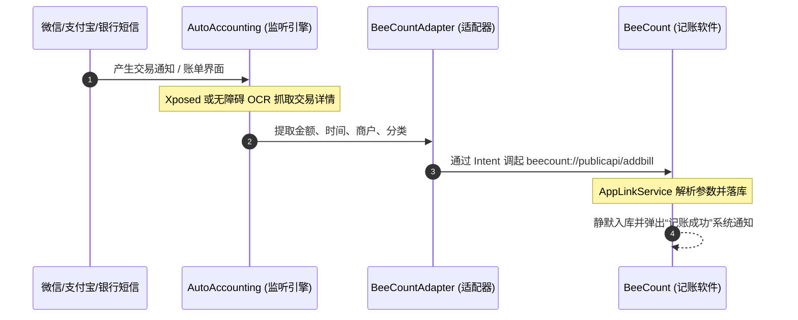

# BeeCount 自动记账生态适配与开源套件

本目录包含了将 **[AutoAccounting (自动记账)](https://github.com/AutoAccountingOrg/AutoAccounting)** 完整接入并适配 **BeeCount** 记账软件的全部代码、协议定义、测试工具以及独立开源维护方案。

---

## 一、目录结构

```text
自动记账/
├── README.md                      # 本说明文档（整体方案与指引）
├── 协议规范/
│   └── URL_SCHEME_PROTOCOL.md     # BeeCount URL Scheme 协议白皮书（兼容钱迹标准与原生规范）
├── auto_accounting_adapter/       # AutoAccounting 端适配源码（直接提供给 AutoAccounting 项目）
│   ├── BeeCountAdapter.kt         # 实现 IAppAdapter 的 Kotlin 核心类
│   ├── AppAdapterManager_patch.kt # 官方 AppAdapterManager 注册代码与补丁说明
│   └── README.md                  # AutoAccounting 端集成、编译与提 PR 流程
├── scripts/                       # 联调与测试脚本
│   ├── test_beecount_scheme.sh    # macOS / Linux 下 ADB 自动化模拟记账脚本
│   └── test_beecount_scheme.bat   # Windows 下 ADB 自动化模拟记账脚本
└── github_workflows/              # 独立开源构建 CI/CD
    └── build_auto_accounting.yml  # 独立出包 GitHub Actions 流水线配置模板
```

---

## 二、工作原理与技术架构



---

## 三、接入实施指南

### 步骤 1：BeeCount 记账端准备（已内置就绪）
BeeCount 现已全面升级 `AppLinkService`，原生支持：
- 支持 `beecount://add` 与 `beecount://publicapi/addbill` 两种协议入口。
- 同时兼容 `money`/`amount`、`type` (0/1/2 或 expense/income/transfer)、`cate_name`/`category`、`remark`/`note`、`account_name`/`account`、`auto_save`/`silent` 等所有字段。
- 支持模糊分类容错匹配及默认分类兜底，杜绝因分类名细微差异导致漏记。

### 步骤 2：AutoAccounting 端添加适配器
1. Fork [AutoAccountingOrg/AutoAccounting](https://github.com/AutoAccountingOrg/AutoAccounting) 仓库。
2. 将 `auto_accounting_adapter/BeeCountAdapter.kt` 复制到其 `app/src/main/java/net/ankio/auto/adapter/` 目录。
3. 在 `AppAdapterManager.kt` 中添加 `BeeCountAdapter()` 注册项。

### 步骤 3：本地调试与验证
1. 连接安装了 BeeCount 的 Android 手机或模拟器。
2. 在电脑终端运行调试脚本：
   ```bash
   # macOS / Linux
   ./自动记账/scripts/test_beecount_scheme.sh

   # Windows
   自动记账\scripts\test_beecount_scheme.bat
   ```
3. 验证手机上 BeeCount 是否收到支出、收入、转账记录，并且金额、账户与分类均正确入库。

---

## 四、独立使用与后续开源策略

1. **独立发布形态（快速向用户提供）**：
   - 在个人/组织 GitHub 仓库下独立维护 AutoAccounting 的 Fork 仓库。
   - 使用 `github_workflows/build_auto_accounting.yml` 自动打 Release APK。
   - 在 BeeCount 内部设置页提供“下载自动记账助手”引导。
2. **零侵入同步上游更新（长期无冲突 Rebase）**：
   - 适配器代码独立于 `BeeCountAdapter.kt`，仅在 `AppAdapterManager` 注册一行。
   - 上游官方更新微信/支付宝 Hook 算法时，运行 `git fetch upstream && git rebase upstream/master` 即可零冲突同步。
3. **向 AutoAccounting 官方提交 PR**：
   - 当测试稳定后，以 `feat(adapter): add BeeCount app adapter` 为标题向官方仓库提 PR。
   - 官方合并后，原版 AutoAccounting 用户无需任何定制即可直接使用 BeeCount。
